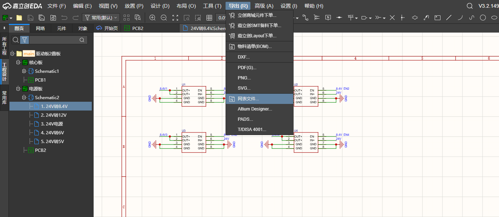
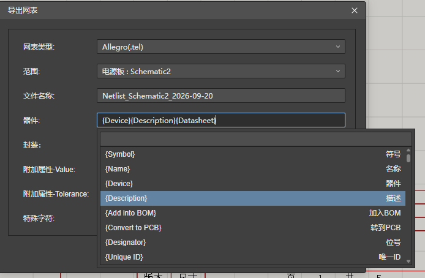
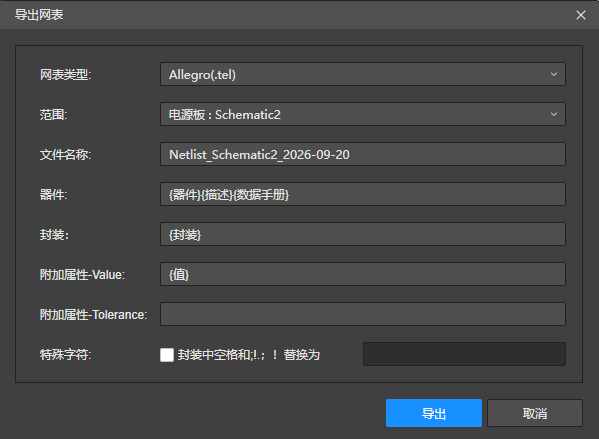

# schematic-reviewer — 原理图检查 skill（WorkBuddy / Codex 双平台）

一套源码，两种装法。仓库里只维护**一份** skill 源，靠平台标记和路径占位符渲染出
WorkBuddy（Windows + Git Bash）与 Codex 两套可直接安装的产物。

## 包含的 skill

| skill | 作用 |
|---|---|
| [schematic-reviewer](skills/schematic-reviewer/) | 原理图检查与审核。读芯片数据手册做逐引脚分析，检查去耦、上拉、匹配等外围电路是否缺失或参数错误，识别大电流路径并按 IPC-2221 计算走线宽度，通过立创/JLC 接口核实元器件规格与现货库存。 |

## 仓库结构

```
.
|-- README.md                    本文件：总览、构建与安装说明
|-- build.py                     构建器：单一源 -> dist/<平台>/
|-- platforms/                   平台适配定义
|   |-- README.md                平台标记与占位符语法
|   |-- workbuddy.json           WorkBuddy：变量、安装目录
|   |-- codex.json               Codex：变量、安装目录
|   `-- codex/overlay/           Codex 专属文件（agents/openai.yaml）
|-- skills/                      唯一需要维护的源码
|   `-- schematic-reviewer/
|       |-- SKILL.md             主流程与约束（含平台标记）
|       |-- README.md            skill 级别说明
|       |-- references/          外部 checklist 索引、立创接口用法、外围电路规则、载流速查表
|       |-- scripts/             5 个纯标准库脚本
|       `-- tests/               4 个回归测试，共 23 项
|-- docs/images/                 嘉立创 EDA 导出操作截图
`-- dist/                        构建产物，不入库（见 .gitignore）
```

## 构建

需要 Python 3.8+，只用标准库。

```bash
python build.py                     # 构建全部平台到 dist/
python build.py --platform codex    # 只构建指定平台
python build.py --check             # 只校验模板能否渲染，不写 dist/
python build.py --install workbuddy # 构建并直接装到 ~/.workbuddy/skills
python build.py --clean             # 删除 dist/
```

`--install` 覆盖同名 skill 前会先把原目录改名成 `<skill>.backup-<时间戳>` 留档。

产物：

```
dist/workbuddy/schematic-reviewer/    # 拷到 ~/.workbuddy/skills/ 即可
dist/codex/schematic-reviewer/        # 拷到 ~/.codex/skills/ 即可
dist/<平台>/BUILD.json                # 本次构建的平台、变量与文件清单
```

### 为什么要有构建这一步

两套产物 90% 的内容是一样的，差异只有三处：

1. **工具映射**：WorkBuddy 用 Read / WebFetch / Bash，Codex 用 `pdf` skill 与 shell 抓取。
2. **跑脚本的方式**：WorkBuddy 用托管 Python 绝对路径，Codex 用相对路径 `python scripts/...`。
3. **frontmatter 与专属文件**：WorkBuddy 多 `agent_created` / `metadata.short-description`；
   Codex 多 `agents/openai.yaml`。

把这三处抽出来之后，脚本、测试、参考资料只留一份，不会再出现「改了一边忘了另一边」的漂移。
语法细节见 [platforms/README.md](platforms/README.md)。

## 安装

### WorkBuddy

```bash
python build.py --install workbuddy
```

或手动拷贝：

```bash
cp -r dist/workbuddy/schematic-reviewer ~/.workbuddy/skills/
```

装好后 skill 目录下的 `SKILL.md` 会带一段「WorkBuddy 环境适配」，其中定义了脚本目录与
托管 Python 解释器；本技能会据此用 `"$PY" "$SK/xxx.py"` 的形式调用脚本。

### Codex

```bash
python build.py --install codex
```

或手动拷贝：

```bash
cp -r dist/codex/schematic-reviewer ~/.codex/skills/
```

## 使用步骤（嘉立创 EDA 导出网表 → 让 AI 检查）

### 第 1 步：在原理图界面点击导出

打开嘉立创 EDA 的原理图，点击顶部菜单「导出(R)」→「网表文件...」。



### 第 2 步：选择需要的信息

在弹出的「导出网表」窗口中：

- 网表类型：Allegro(.tel)
- 范围：选择要检查的原理图（如 `电源板 : Schematic2`）
- 器件：建议**只保留「器件 {Device}」「描述 {Description}」「数据手册 {Datasheet}」三项**，
  即 `{Device}{Description}{Datasheet}`；封装、附加属性（Value/Tolerance）等无需勾选

在「器件」输入框中选择这三个字段：



确认器件栏显示为「(器件)(描述)(数据手册)」后，点击「导出」，保存生成的 .tel 网表文件：



### 第 3 步：把文件地址发给 AI

将导出的网表文件完整路径（文件地址）发送给 WorkBuddy 或 Codex。

### 第 4 步：使用 skill 检查原理图

让 AI 调用 `schematic-reviewer` skill 检查这份网表，即可得到外围电路、载流走线加宽、
元器件选型与库存等方面的问题清单。

## 验证

```bash
cd skills/schematic-reviewer
python tests/test_review_export.py
python tests/test_lcsc_lookup.py
python tests/test_parse_schematic_export.py
python tests/test_parse_tel_netlist.py
```

23 项回归测试全部通过即脚本正常。也可以在构建后校验产物：

```bash
python build.py --check             # 模板渲染校验（残留标记/未定义占位符会直接报错）
```

`test_lcsc_lookup.py` 与 `review_export.py` 的批量核验需要访问 `jlcpcb.com`；
离线环境下这部分用例会跳过或报网络错误，其余用例不受影响。

## 环境要求

- Python 3.8+，脚本只依赖标准库
- 可访问 `jlcpcb.com`（元器件接口）与厂商数据手册站点
- WorkBuddy 或 Codex 任一环境；两侧产物互不影响

## 已知限制

- 无浏览器自动化：立创商城网页是 JS 单页应用，抓 HTML 拿不到商品数据，必须走接口。
- 嘉立创 EDA/BOM 导出通常只有器件参数，没有网络连接；不能据此判断具体引脚接线。
  带 `$NETS` 的 `.tel` 可以核对 `位号.引脚号`，但仍没有坐标和封装引脚名。
- 元器件接口为第三方公开接口，无鉴权但可能变更；失效时脚本会明确报错，需重新探查接口。
- 立创手册链接是在线阅读页而非 PDF 直链，数据手册优先从厂商官网取。
